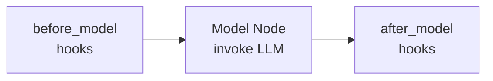
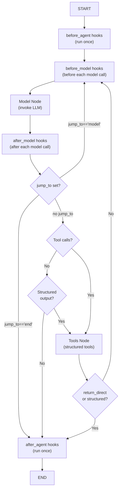

# Agent Execution: create_agent and Middleware Pipeline

The `create_agent()` factory function in LangChain constructs agentic systems by orchestrating language models, tools, and middleware into a structured loop. This document explains the factory's architecture, middleware composition patterns, and execution control mechanisms.

## The Agent Factory Pattern

### Purpose and Responsibilities

`create_agent()` is a factory function that:

1. **Resolves and initializes the model**: Converts string identifiers (e.g., `"openai:gpt-4o"`) to `BaseChatModel` instances.
2. **Normalizes tools**: Converts Python callables to `BaseTool` instances, preserves existing tools.
3. **Composes middleware**: Chains middleware hooks and wrappers in registration order.
4. **Constructs the execution graph**: Builds a LangGraph `StateGraph` with nodes for model, tools, and middleware.
5. **Compiles and returns**: Returns a `CompiledStateGraph` ready for sync/async execution.

### Minimal Example

```python
from langchain.agents import create_agent
from langchain_openai import ChatOpenAI
from langchain_core.tools import tool

@tool
def search(query: str) -> str:
    """Search for information."""
    return f"Results for {query}"

agent = create_agent(
    model="openai:gpt-4o",
    tools=[search],
    system_prompt="You are a helpful assistant"
)

result = agent.invoke({"messages": [{"role": "user", "content": "Search for AI news"}]})
print(result["messages"][-1].content)
```

### Factory Signature

```python
def create_agent(
    model: str | BaseChatModel,
    tools: Sequence[BaseTool | Callable[..., Any] | dict[str, Any]] | None = None,
    *,
    system_prompt: str | SystemMessage | None = None,
    middleware: Sequence[AgentMiddleware[StateT_co, ContextT]] = (),
    response_format: ResponseFormat[ResponseT] | type[ResponseT] | None = None,
    state_schema: type[AgentState[ResponseT]] | None = None,
    context_schema: type[ContextT] | None = None,
    checkpointer: Checkpointer | None = None,
    store: BaseStore | None = None,
    interrupt_before: list[str] | None = None,
    interrupt_after: list[str] | None = None,
    debug: bool = False,
    name: str | None = None,
    cache: BaseCache[Any] | None = None,
    transformers: Sequence[TransformerFactory] | None = None,
) -> CompiledStateGraph[AgentState[ResponseT], ContextT, InputAgentState, OutputAgentState[ResponseT]]
```

## Agent State Schema

Every agent operates over an `AgentState` that persists across the execution loop:

```python
class AgentState(TypedDict, Generic[ResponseT]):
    """State schema for the agent."""
    messages: Required[Annotated[list[AnyMessage], add_messages]]
    jump_to: NotRequired[Annotated[JumpTo | None, EphemeralValue]]
    structured_response: NotRequired[Annotated[ResponseT, OmitFromOutput]]
```

**State fields:**

- **`messages`**: Conversation history, merged via `add_messages` reducer (new messages append, not replace).
- **`jump_to`**: Ephemeral routing hint set by middleware to override default flow (`"tools"`, `"model"`, or `"end"`).
- **`structured_response`**: Parsed output when `response_format` is configured (omitted from input schema).

Middleware can extend `AgentState` via `state_schema` parameter. When multiple middleware extend state, schemas are merged in registration order with user-provided `state_schema` always winning field conflicts.

## Middleware Architecture

### Hook-Based Middleware (Node Hooks)

Node hooks run at specific execution points and return state updates:

```python
class MyMiddleware(AgentMiddleware):
    def before_agent(self, state: AgentState, runtime: Runtime) -> dict[str, Any] | None:
        """Called once before agent execution starts."""
        return {"custom_field": "value"}
    
    def before_model(self, state: AgentState, runtime: Runtime) -> dict[str, Any] | None:
        """Called before each model invocation (runs in loop)."""
        return None
    
    def after_model(self, state: AgentState, runtime: Runtime) -> dict[str, Any] | None:
        """Called after each model invocation (runs in loop)."""
        return None
    
    def after_agent(self, state: AgentState, runtime: Runtime) -> dict[str, Any] | None:
        """Called once after agent execution completes."""
        return None
```

**Routing via `jump_to`:**

Hooks can set `state["jump_to"]` to alter execution flow:

- `"model"`: Jump back to before_model (skip tools, restart model invocation).
- `"tools"`: Jump to tools node (force tool execution).
- `"end"`: Skip to agent termination.

### Wrapper-Based Middleware (Handler Wraps)

Wrappers intercept and control core operations by wrapping handler callbacks:

#### `wrap_model_call` – Model Execution Control

```python
class RetryMiddleware(AgentMiddleware):
    def wrap_model_call(self, request: ModelRequest, handler):
        """Retry model call up to 3 times on error."""
        for attempt in range(3):
            try:
                response = handler(request)  # Call the model
                return response
            except Exception as e:
                if attempt == 2:
                    raise
                print(f"Attempt {attempt + 1} failed: {e}")
```

The `handler` callback executes the model request and returns `ModelResponse`. Middleware can:

- **Retry** on transient errors (exponential backoff).
- **Cache** responses by request hash.
- **Fallback** to a different model.
- **Modify request** (tools, system message, model settings).
- **Rewrite response** (transform AI message content).
- **Short-circuit** by not calling the handler (return cached result).

**Return types:**

- `ModelResponse`: Full response with messages and optional structured output.
- `AIMessage`: Simplified response (auto-converted to `ModelResponse`).
- `ExtendedModelResponse`: Response + `Command` for additional state updates.

#### `wrap_tool_call` – Tool Execution Control

```python
class ToolValidationMiddleware(AgentMiddleware):
    def wrap_tool_call(self, request, handler):
        """Validate tool arguments before execution."""
        # Modify the tool call if needed
        modified_call = {**request.tool_call, "args": {...}}
        request = request.override(tool_call=modified_call)
        
        # Execute the tool
        result = handler(request)  # Returns ToolMessage or Command
        return result
```

The `handler` callback executes the tool and returns `ToolMessage | Command`. Middleware can:

- **Validate** tool arguments before execution.
- **Retry** on errors or invalid outputs.
- **Monitor** tool usage and cost.
- **Modify calls** (transform arguments, inject context).
- **Mock** tools for testing.

**Return types:**

- `ToolMessage`: Tool execution result.
- `Command`: Route to a different node or update state.

### Middleware Composition and Ordering

Middleware is applied in **first-in, outermost** order:

```python
middleware = [CacheMiddleware(), RetryMiddleware(), LoggingMiddleware()]
agent = create_agent(model="openai:gpt-4o", tools=[...], middleware=middleware)
```

**Execution order for `wrap_model_call`:**

- Request flows: `CacheMiddleware` → `RetryMiddleware` → `LoggingMiddleware` → actual model
- Response flows: actual model → `LoggingMiddleware` → `RetryMiddleware` → `CacheMiddleware`

**State schema composition:**

Middleware state schemas are merged in registration order:

1. `middleware[0].state_schema`
2. `middleware[1].state_schema`
3. ...
4. `agent.state_schema` (if provided, wins all conflicts)

This allows the caller's explicit `state_schema` to override middleware annotations.

## Tool Binding and Execution

### Tool Types

The factory accepts three formats:

1. **BaseTool instances** (preferred):
   ```python
   from langchain_core.tools import tool
   
   @tool
   def search(query: str) -> str:
       """Search for information."""
       return f"Results for {query}"
   
   agent = create_agent(model="openai:gpt-4o", tools=[search])
   ```

2. **Python callables** (auto-wrapped):
   ```python
   def search(query: str) -> str:
       """Search for information."""
       return f"Results for {query}"
   
   agent = create_agent(model="openai:gpt-4o", tools=[search])
   ```

3. **Dict schemas** (provider built-ins):
   ```python
   tools = [
       {
           "type": "builtin_text_search",  # Provider-specific
           "name": "search",
           "description": "Search for information"
       }
   ]
   agent = create_agent(model="anthropic:claude-opus", tools=tools)
   ```

### Tool Binding Process

Before calling the model, `create_agent` binds tools via `model.bind_tools()`:

```python
bound_model = model.bind_tools(
    final_tools,
    tool_choice=tool_choice,  # "any", "required", specific name, or None
    **model_settings
)
```

The factory creates a `ToolNode` that:

1. **Receives**: Model's `AIMessage` with `tool_calls`.
2. **Matches**: Each call to a registered tool by name.
3. **Executes**: Tool (sync or async, error handling included).
4. **Wraps**: Result in `ToolMessage` with tool call ID and name.
5. **Applies middleware**: `wrap_tool_call` handlers intercept execution.

If a tool call fails during execution, the framework automatically generates an error `ToolMessage` and loops back to the model for recovery.

## Structured Output Handling

When `response_format` is configured, the factory handles three strategies:

- **ProviderStrategy**: Uses the model's native API (e.g., OpenAI's response_format).
- **ToolStrategy**: Creates pseudo-tools for each schema; model calls the tool to return structured data.
- **AutoStrategy**: Auto-detects the best strategy based on model capabilities.

When ToolStrategy is used, the agent:

1. Adds structured tools to the model's tool list.
2. Executes the tool call to parse the schema.
3. Stores the parsed result in `state["structured_response"]`.
4. Routes to termination (not looping back for more tools).

## The Agentic Loop

The core execution loop iterates through three main phases:

### Phase 1: Model Invocation



1. `before_model` middleware hooks execute (state updates applied).
2. Model is invoked with system prompt, messages, and bound tools.
3. `after_model` middleware hooks execute (state updates applied).
4. Response is handled (structured output parsing, invalid tool repair).

### Phase 2: Conditional Routing

After the model produces a response, the agent decides what to do next:

- **If `state["jump_to"]` is set**: Use it to route to target node.
- **Else if `AIMessage.tool_calls` is present**: Route to tools node.
- **Else if no tool calls and no structured output**: Route to termination.

### Phase 3: Tool Execution

If routing to tools:

1. Matches each tool call to a registered tool.
2. Executes the tool (wrapped by middleware `wrap_tool_call` handlers).
3. Returns `ToolMessage` with result.
4. Determines routing: loop back to model, or exit if `return_direct=True` or structured output was produced.

### Loop Termination

The agent stops when:

- The model produces an `AIMessage` with no tool calls.
- A tool has `return_direct=True` and produces output.
- A structured output tool completes (automatic termination with `ToolStrategy`).
- `state["jump_to"] == "end"` is set by middleware.

At termination, `after_agent` hooks run once (cleanup, logging, state finalization), and the graph returns final state (messages + optional structured response).

### Full Control Flow Diagram



## ModelRequest and Response Types

### ModelRequest

The request object passed to `wrap_model_call` handlers:

```python
@dataclass
class ModelRequest(Generic[ContextT]):
    model: BaseChatModel
    messages: list[AnyMessage]  # excluding system message
    system_message: SystemMessage | None
    tool_choice: Any | None
    tools: list[BaseTool | dict[str, Any]]
    response_format: ResponseFormat[Any] | None
    state: AgentState[Any]
    runtime: Runtime[ContextT]
    model_settings: dict[str, Any] = field(default_factory=dict)
```

The `override()` method creates new requests with modified fields immutably:

```python
new_request = request.override(
    model=different_model,
    system_message=SystemMessage(content="New instructions"),
    tools=filtered_tools
)
```

### ModelResponse and ExtendedModelResponse

```python
@dataclass
class ModelResponse(Generic[ResponseT]):
    result: list[BaseMessage]  # Usually contains AIMessage
    structured_response: ResponseT | None = None

@dataclass
class ExtendedModelResponse(Generic[ResponseT]):
    model_response: ModelResponse[ResponseT]
    command: Command[Any] | None = None  # For state updates
```

## Synchronous vs. Asynchronous Execution

`create_agent` returns a compiled graph supporting both sync and async execution:

```python
# Synchronous
result = agent.invoke({"messages": [...]})

# Asynchronous
result = await agent.ainvoke({"messages": [...]})

# Streaming (sync)
for chunk in agent.stream({"messages": [...]}, stream_mode="updates"):
    print(chunk)

# Streaming (async)
async for chunk in agent.astream({"messages": [...]}):
    print(chunk)
```

The graph automatically chooses sync or async based on the execution context. If middleware implements only async (`awrap_model_call`) and is invoked synchronously, it raises `NotImplementedError`. Provide both implementations for maximum compatibility.

## Execution Configuration

### Loop Control

The agent loop has a default recursion limit of 9,999 iterations. Configure per invocation:

```python
result = agent.invoke(
    {"messages": [...]},
    config={"recursion_limit": 100}  # Custom limit
)
```

### Human-in-the-Loop

Pause execution before/after named nodes:

```python
agent = create_agent(
    model="openai:gpt-4o",
    tools=[...],
    interrupt_before=["tools"],  # Pause before tool execution
    interrupt_after=["model"]     # Pause after model invocation
)
```

### Debug Mode

Enable verbose logging:

```python
agent = create_agent(
    model="openai:gpt-4o",
    tools=[...],
    debug=True
)

result = agent.invoke({"messages": [...]})
# Prints: node transitions, state updates, execution trace
```

## Observability and Tracing

All agent execution is automatically traced to LangSmith (if configured). Traces capture:

- **Model node invocations** (with tool bindings and system prompt).
- **Middleware hooks** (before/after execution points).
- **wrap_model_call and wrap_tool_call** interceptions (request/response details).
- **Tool executions** (with arguments, results, and errors).
- **State transitions** (messages, structured response, routing decisions).

Middleware can configure trace privacy via `trace_policy`:

```python
from langgraph.types import TracePolicy, omit_payload

class MyMiddleware(AgentMiddleware):
    trace_policy = TracePolicy(process_inputs=omit_payload)  # Hide sensitive inputs
```

Access runtime context in middleware hooks:

```python
class ObservableMiddleware(AgentMiddleware):
    def before_model(self, state: AgentState, runtime: Runtime) -> dict[str, Any] | None:
        print(f"Step {runtime.step_number}: {len(state['messages'])} messages")
        return None
```

## Error Handling

### Invalid Tool Calls

When a model generates a tool call with malformed arguments or unknown tool name, the agent automatically patches these by inserting error `ToolMessage` objects before retrying. Middleware can intercept via `wrap_model_call` or `after_model` hooks.

### Middleware-Induced Tool Mismatches

If middleware adds tools via `wrap_model_call` but doesn't handle their execution:

```
ValueError: Middleware added tools that the agent doesn't know how to execute.
Unknown tools: [dynamic_tool]
Registered tools: [search, calculate]
```

**Solutions:**

1. Register tools upfront via `create_agent(tools=[...])`.
2. Implement `wrap_tool_call` in the middleware to handle dynamic tools.
3. Use dict-based provider tools that the model natively supports.

### Async-Sync Context Mismatch

If middleware implements only async (`awrap_model_call`) but invoked synchronously:

```
NotImplementedError: Synchronous implementation of wrap_model_call is not available.
```

**Solutions:**

1. Implement both `wrap_model_call` and `awrap_model_call`.
2. Invoke the agent asynchronously: `agent.ainvoke()` or `agent.astream()`.

## Common Middleware Patterns

### Pattern 1: Tool Selection and Routing

Narrow tools based on context:

```python
from langchain.agents import AgentMiddleware, ModelRequest

class ContextualToolSelector(AgentMiddleware):
    def wrap_model_call(self, request: ModelRequest, handler):
        # Filter tools based on user context
        user_level = request.state.get("user_level", "basic")
        if user_level != "admin":
            tools = [t for t in request.tools if "admin" not in t.name]
            request = request.override(tools=tools)
        return handler(request)
```

### Pattern 2: Retry and Error Recovery

Implement exponential backoff:

```python
import asyncio
from langchain.agents import AgentMiddleware, ModelRequest, ModelResponse
from langchain_core.messages import AIMessage

class SmartRetryMiddleware(AgentMiddleware):
    async def awrap_model_call(self, request: ModelRequest, handler):
        backoff = 1
        for attempt in range(3):
            try:
                return await handler(request)
            except Exception as e:
                if attempt < 2:
                    await asyncio.sleep(backoff)
                    backoff *= 2
                else:
                    return ModelResponse(
                        result=[AIMessage(content="I encountered an error. Please try again.")]
                    )
```

### Pattern 3: Output Validation

Post-process and validate responses:

```python
from langchain.agents import AgentMiddleware, ModelResponse
from langchain_core.messages import AIMessage

class OutputValidatorMiddleware(AgentMiddleware):
    def wrap_model_call(self, request, handler):
        response = handler(request)
        # Ensure response is ModelResponse
        if isinstance(response, AIMessage):
            response = ModelResponse(result=[response])
        
        # Validate and transform
        ai_msg = response.result[0]
        if not ai_msg.content:
            ai_msg.content = "No response generated"
        
        return response
```

### Pattern 4: Tool Error Handling

Handle tool execution failures:

```python
from langchain.agents import AgentMiddleware
from langchain_core.messages import ToolMessage

class ToolErrorHandlerMiddleware(AgentMiddleware):
    def wrap_tool_call(self, request, handler):
        try:
            return handler(request)
        except Exception as e:
            return ToolMessage(
                content=f"Tool error: {str(e)}. Please retry or use a different tool.",
                tool_call_id=request.tool_call["id"],
                name=request.tool_call["name"],
                status="error"
            )
```

## Integration with LangGraph

Agents created by `create_agent()` are LangGraph `StateGraph` instances that can:

1. **Be subgraphs**: Added to larger agent networks for multi-agent systems.
2. **Use interrupts**: Pause execution for human review before/after nodes.
3. **Stream outputs**: Real-time token-by-token responses via `stream()` or `astream()`.
4. **Support nested graphs**: Hierarchical agentic structures.
5. **Use checkpointing**: Persist state per conversation thread for resumption.
6. **Access stores**: Cross-thread persistence for context across conversations.

The `name` parameter helps identify subagents in trace logs and error messages.

## Practical Example: Multi-Tool Planner Agent

```python
from langchain.agents import create_agent, AgentMiddleware, ModelRequest, ModelResponse
from langchain_core.tools import tool
from langchain_core.messages import AIMessage, HumanMessage
from langchain_openai import ChatOpenAI

# Define tools
@tool
def search(query: str) -> str:
    """Search the web."""
    return f"Results for: {query}"

@tool
def calculate(expr: str) -> str:
    """Evaluate a math expression."""
    return str(eval(expr))

# Middleware for planning
class PlannerMiddleware(AgentMiddleware):
    def before_agent(self, state, runtime):
        # Inject a planning step at the start
        plan_request = HumanMessage(
            content="First, make a plan for how to solve this problem. Then execute it."
        )
        return {"messages": [plan_request]}

# Create agent
agent = create_agent(
    model=ChatOpenAI(model="gpt-4o"),
    tools=[search, calculate],
    system_prompt="You are a helpful assistant with access to search and math tools.",
    middleware=[PlannerMiddleware()],
    debug=True
)

# Run
result = agent.invoke({
    "messages": [{"role": "user", "content": "What is the population of France times 2?"}]
})

print(result["messages"][-1].content)
```
